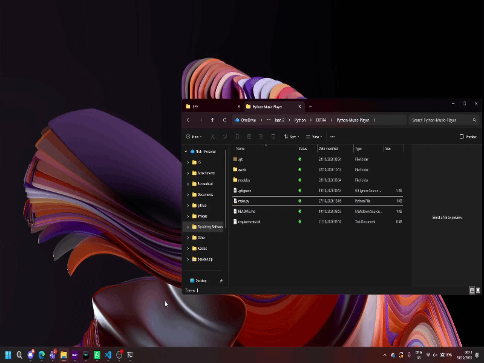

# Python-Music-Player
Simple python music player that currently plays one song (Unfinished)

# Technologies
* ```Python``` As programming language
* ```Tkinter``` For the UI
* Type checked scripts
* ```Pillow``` for images and other ui elements

# Features
* A ui with three buttons: Skip left, Pause/Play, Skip right (Skip left and right currently reset the song)
* Cover art appears above player if present
* Music output (you can program in your own songs manually)

# Requirements
* Python 3.13
## Modules
* Numpy
* Pillow
* Tkinter
* ffmpeg
* pyaudio
* Pathlib

# Preview


